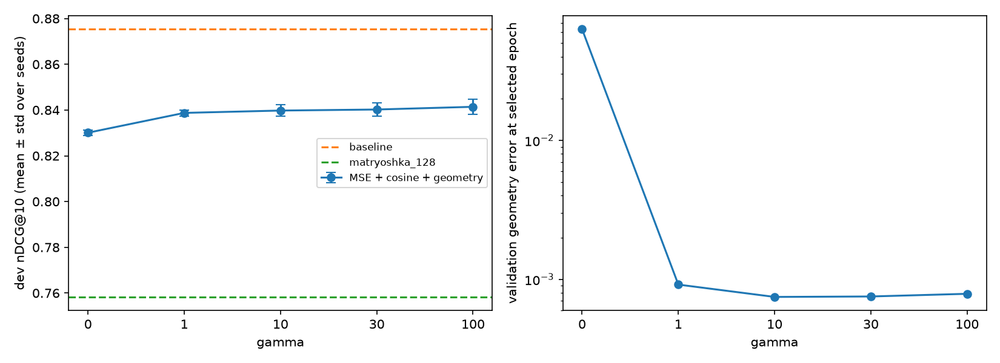
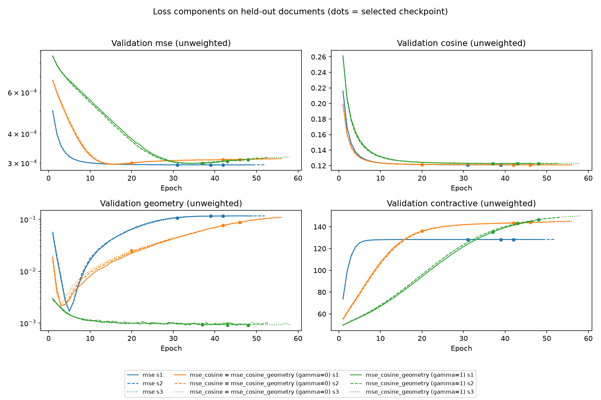
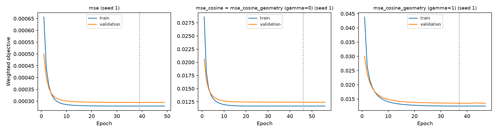
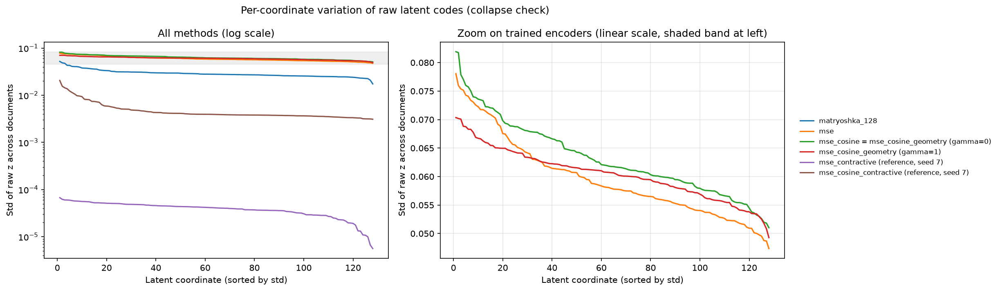

# Analysis: final (test) and gamma-sweep-3seed (dev)

Generated by `applications/analysis.py`; no model was retrained.

## Development sweep

| gamma | runs | nDCG@10 | nDCG@10_std | validation_geometry |
|---|---:|---:|---:|---:|
| 0 | 3 | 0.8301 | 0.0012 | 6.31e-02 |
| 1 | 3 | 0.8388 | 0.0013 | 9.17e-04 |
| 10 | 3 | 0.8398 | 0.0025 | 7.47e-04 |
| 30 | 3 | 0.8402 | 0.0030 | 7.53e-04 |
| 100 | 3 | 0.8414 | 0.0033 | 7.87e-04 |

## Collapse diagnostics (all 5,183 documents)

Raw = encoder output before L2 normalization; unit = normalized vectors used for retrieval. Effective dimension = participation ratio of the covariance eigenvalues of the normalized vectors. It is scale-invariant, so it cannot detect collapse by itself; use raw coordinate std and mean pairwise cosine for that.

| run | dimension | raw_mean_norm | raw_mean_coord_std | raw_min_coord_std | raw_coords_std_lt_1e-3 | saturated_fraction_abs_gt_0.99 | mean_pairwise_cosine | effective_dimension |
|---|---:|---:|---:|---:|---:|---:|---:|---:|
| baseline | 768 | 1.000 | 2.91e-02 | 1.63e-02 | 0 | 0.0000 | 0.3372 | 106.2 |
| matryoshka_128 | 128 | 0.402 | 2.92e-02 | 1.74e-02 | 0 | 0.0000 | 0.3105 | 62.7 |
| mse s1 | 128 | 0.679 | 5.96e-02 | 4.74e-02 | 0 | 0.0000 | 0.0050 | 52.9 |
| mse s2 | 128 | 0.678 | 5.94e-02 | 4.74e-02 | 0 | 0.0000 | 0.0040 | 52.9 |
| mse s3 | 128 | 0.683 | 5.96e-02 | 4.74e-02 | 0 | 0.0000 | 0.0191 | 52.7 |
| mse_cosine s1 | 128 | 0.734 | 6.32e-02 | 5.10e-02 | 0 | 0.0000 | 0.0486 | 52.8 |
| mse_cosine s2 | 128 | 0.741 | 6.30e-02 | 4.99e-02 | 0 | 0.0000 | 0.0679 | 52.7 |
| mse_cosine s3 | 128 | 0.770 | 6.15e-02 | 4.86e-02 | 0 | 0.0000 | 0.1846 | 52.3 |
| mse_cosine_geometry (gamma=0) s1 | 128 | 0.734 | 6.32e-02 | 5.10e-02 | 0 | 0.0000 | 0.0486 | 52.8 |
| mse_cosine_geometry (gamma=0) s2 | 128 | 0.741 | 6.30e-02 | 4.99e-02 | 0 | 0.0000 | 0.0679 | 52.7 |
| mse_cosine_geometry (gamma=0) s3 | 128 | 0.770 | 6.15e-02 | 4.86e-02 | 0 | 0.0000 | 0.1846 | 52.3 |
| mse_cosine_geometry (gamma=1) s1 | 128 | 0.833 | 6.04e-02 | 4.93e-02 | 0 | 0.0000 | 0.3321 | 59.1 |
| mse_cosine_geometry (gamma=1) s2 | 128 | 0.857 | 6.20e-02 | 4.92e-02 | 0 | 0.0000 | 0.3325 | 59.5 |
| mse_cosine_geometry (gamma=1) s3 | 128 | 0.867 | 6.27e-02 | 5.32e-02 | 0 | 0.0000 | 0.3330 | 59.8 |
| mse_contractive (reference, seed 7) s7 | 128 | 0.555 | 3.95e-05 | 5.61e-06 | 128 | 0.0000 | 1.0000 | 48.3 |
| mse_cosine_contractive (reference, seed 7) s7 | 128 | 0.065 | 4.89e-03 | 3.10e-03 | 0 | 0.0000 | 0.0560 | 29.6 |

## Exact cosine search versus Chroma HNSW (test, mean over seeds)

| method | runs | hnsw_nDCG@10 | exact_nDCG@10 | hnsw_Recall@100 | exact_Recall@100 | top100_overlap |
|---|---:|---:|---:|---:|---:|---:|
| baseline | 1 | 0.7817 | 0.7817 | 0.9833 | 0.9867 | 0.9945 |
| matryoshka_128 | 1 | 0.6784 | 0.6783 | 0.9272 | 0.9272 | 0.9921 |
| mse | 3 | 0.7409 | 0.7409 | 0.9787 | 0.9798 | 0.9979 |
| mse_cosine | 3 | 0.7442 | 0.7442 | 0.9816 | 0.9816 | 0.9980 |
| mse_cosine_geometry (gamma=0) | 3 | 0.7442 | 0.7442 | 0.9804 | 0.9816 | 0.9980 |
| mse_cosine_geometry (gamma=1) | 3 | 0.7498 | 0.7498 | 0.9809 | 0.9809 | 0.9976 |

## Paired comparison on test nDCG@10 (exact search)

Per-seed deltas pair runs with the same initialization seed. The confidence interval bootstraps the 300 test queries (10,000 resamples) using each query's delta averaged over seeds; it captures query sampling, not seed variability.

| comparison | seeds | per_seed_deltas | mean_delta | ci95_low | ci95_high | queries_better | queries_worse | queries_tied |
|---|---:|---:|---:|---:|---:|---:|---:|---:|
| mse_cosine_geometry (gamma=1) minus mse | 3 | +0.0073, +0.0082, +0.0112 | +0.0089 | +0.0007 | +0.0175 | 50 | 31 | 219 |
| mse_cosine_geometry (gamma=1) minus mse_cosine | 3 | +0.0045, +0.0060, +0.0062 | +0.0056 | -0.0003 | +0.0116 | 47 | 27 | 226 |
| mse_cosine_geometry (gamma=1) minus mse_cosine_geometry (gamma=0) | 3 | +0.0045, +0.0060, +0.0062 | +0.0056 | -0.0003 | +0.0116 | 47 | 27 | 226 |

## Storage and size (raw float32 vectors, excluding index overhead)

| method | dimension | bytes_per_document | corpus_MB | encoder_parameters | mean_training_seconds |
|---|---:|---:|---:|---:|---:|
| baseline | 768 | 3072 | 15.92 | 0 |  |
| matryoshka_128 | 128 | 512 | 2.65 | 0 |  |
| mse | 128 | 512 | 2.65 | 99200 | 19.9 |
| mse_cosine | 128 | 512 | 2.65 | 99200 | 24.0 |
| mse_cosine_geometry (gamma=0) | 128 | 512 | 2.65 | 99200 | 22.3 |
| mse_cosine_geometry (gamma=1) | 128 | 512 | 2.65 | 99200 | 25.2 |

## Dev query-level effect

{'queries': 809, 'improved': 115, 'worse': 62, 'unchanged': 632, 'consistently_improved_all_seeds': 24, 'consistently_worse_all_seeds': 10}

See [query_examples.md](query_examples.md).
